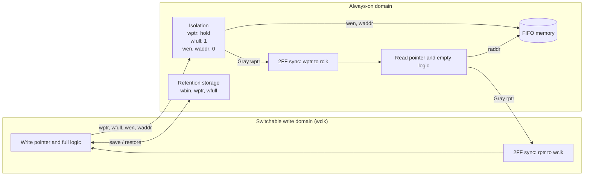
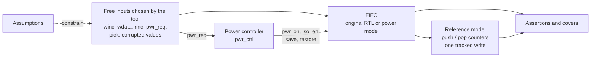
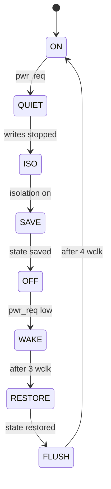

# Low-Power Async FIFO: Formal Verification

Formal property verification of a dual-clock FIFO with a switchable write domain, using SystemVerilog Assertions and Cadence Jasper FPV.

> **Scope:** power behaviour is checked against a **hand-written power-aware model**. This flow does not read UPF and does not use Jasper LPV.

## 1. Design architecture

The write logic can be powered off. The read logic and memory stay on, so stored data can still be read.



`wfull` after isolation is the FIFO's output to the producer. `wdata` enters the memory and `rdata` leaves it.

## 2. Formal testbench



The power controller is used only with the power model.

## 3. Power sequence

`pwr_req` is chosen freely by the tool, subject to the assumptions below. The order of the steps is fixed.



| State | `pwr_on` | `iso_en` | Action |
|---|---|---|---|
| ON | 1 | 0 | Normal operation |
| QUIET | 1 | 0 | Producer is quiet before isolation |
| ISO | 1 | 1 | Outputs isolated |
| SAVE | 1 | 1 | `ret_save` high |
| OFF | 0 | 1 | Write-domain state takes arbitrary values |
| WAKE | 1 | 1 | Power back, synchronizer refreshes |
| RESTORE | 1 | 1 | `ret_restore` high |
| FLUSH | 1 | 1 | Settle before isolation is removed |

The synchronizer is not retained.

## 4. Verification plan

`base` uses the original RTL with no power events. `pwr` uses the power model.

### Safety

| Property | Intent | Task |
|---|---|---|
| `a_no_overflow` | No write is accepted when the FIFO is full | base, pwr |
| `a_no_underflow` | No read is accepted when the FIFO is empty | base, pwr |
| `a_full_safe` | A full FIFO reports `wfull` | base, pwr |
| `a_empty_safe` | An empty FIFO reports `rempty` | base, pwr |
| `a_data` | The tracked write is read back with the same data | base, pwr |
| `a_wgray`, `a_rgray` | At most one pointer bit changes per step | base, pwr |
| `a_iso_before_off` | The power controller isolates while power is off | pwr |
| `a_off_blocks` | While off, `wfull` is 1 and `wen` is 0 | pwr |
| `a_waddr_iso` | `waddr` is 0 during isolation | pwr |
| `a_wptr_held` | `wptr` stays stable during isolation | pwr |

`a_iso_before_off` checks the verification environment's power controller, not logic inside the FIFO. 
### Forward progress

| Property | Intent | Task |
|---|---|---|
| `a_delivered` | The tracked write is eventually read | base, pwr |
| `a_full_clears` | `wfull` eventually clears, or isolation takes over | base, pwr |
| `a_wakes` | A powered-off domain eventually returns to service | pwr |

### Covers

| Cover | Scenario | Task |
|---|---|---|
| `c_full` | FIFO reports full outside isolation | base, pwr |
| `c_delivered` | The tracked write is read | base, pwr |
| `c_wrap` | The reference write counter wraps | base, pwr |
| `c_off_data` | A read happens while the write domain is off | pwr |
| `c_cycle` | A write happens after a power cycle | pwr |
| `c_full_off` | The FIFO is full while the write domain is off | pwr |
| `c_refill_empty` | FIFO is empty again after reads | base, pwr |
| `c_full_release` | Full clears outside isolation | base, pwr |
| `c_empty_release` | Empty clears | base, pwr |
| `c_push_pop` | Write and read conditions are both true when sampled on `wclk` | base, pwr |
| `c_off_nonempty` | Power turns off with data stored | pwr |
| `c_off_empty` | Power turns off with an empty FIFO | pwr |
| `c_iso_when_full` | Isolation starts while full | pwr |
| `c_drain_off` | FIFO is empty while the write domain is off | pwr |
| `c_two_cycles` | A write happens after at least two restores | pwr |

### Assumptions

| Assumption | Meaning | Obligation on a real system |
|---|---|---|
| `m_quiet` | No writes from the power-down request until wake-up completes | The producer must stop writing |
| `m_reader_fair` | The reader requests again and again | The consumer cannot stall forever |
| `m_wake_fair` (pwr) | `pwr_req` is low again and again | A power-down request cannot last forever |

### Formal coverage

`formal/run_coverage.tcl` requests branch, statement and toggle models, with stimuli, COI and proof coverage, for `base` or `pwr`, one clock ratio at a time. `check_cov` options can differ between Jasper versions.

When reporting coverage:

- State the coverage type, models, configuration and clock ratio.
- Report design and testbench coverage separately.
- Classify each hole: unreachable by design, assumption restriction, missing check or unfinished analysis.
- Record the reason for every exclusion.

Full coverage alone does not show that the design is correct.

## 5. How data integrity works

The reference model counts accepted writes and reads independently of the DUT pointers. The tool uses `pick` to choose any one write, and the model stores its position and data. When the read count reaches that position, `rdata` must match. Because the choice is free, a proof covers any write without a full scoreboard, within the verified configuration.

## 6. Fault injection

| Task | Injected fault | Expected result |
|---|---|---|
| `bug_iso` | `wptr` is clamped to 0 instead of held | At least one counterexample |
| `bug_ret` | `wbin` is not restored after wake-up | At least one counterexample |

A counterexample should be traced to confirm that the injected fault caused it.

## 7. Running

Cadence Jasper and a valid licence are required. Run all commands from the repository root.

```bash
./run.sh                    # all tasks, all clock ratios
./run.sh pwr                # one task
GUI=1 ./run.sh bug_iso      # debug a counterexample
```

`JG` sets the Jasper command and `RATIOS` sets the clock factors (default `1:1 2:3 3:2`). Results are summarised in `logs/summary.txt`.

For a single run without environment variables, edit `CONFIG`, `WF` and `RF` at the top of the Tcl file:

```bash
jg -tcl formal/run_standalone.tcl
jg -tcl formal/run_coverage.tcl     # needs Coverage app access
```

## 8. Repository layout

```text
.
├── README.md
├── .gitignore
├── run.sh                  # batch runs across tasks and clock ratios
├── rtl/
│   └── fifo.sv             # FIFO RTL
└── formal/
    ├── fifo_wr_pa.sv       # power-aware model of the write domain
    ├── pwr_ctrl.sv         # power sequence
    ├── fv_top.sv           # harness, assumptions, assertions, covers
    ├── run.tcl             # used by run.sh
    ├── run_standalone.tcl  # single configuration
    └── run_coverage.tcl    # formal coverage
```

## 9. Limitations

- Configuration: depth 4, 4-bit data.
- Results apply only to the clock setups that were run. They do not cover arbitrary clock relationships.
- Metastability is not modelled. This does not replace CDC analysis.
- The power model is separate hand-written code. It does not verify the UPF, or the original `fifo_wr` module under power-off.
- No gate-level verification or power estimation.

## 10. Next steps

- Run Jasper LPV with the UPF.
- Analyse and document coverage holes.
- Prove larger depths and data widths.
- Run CDC analysis.
